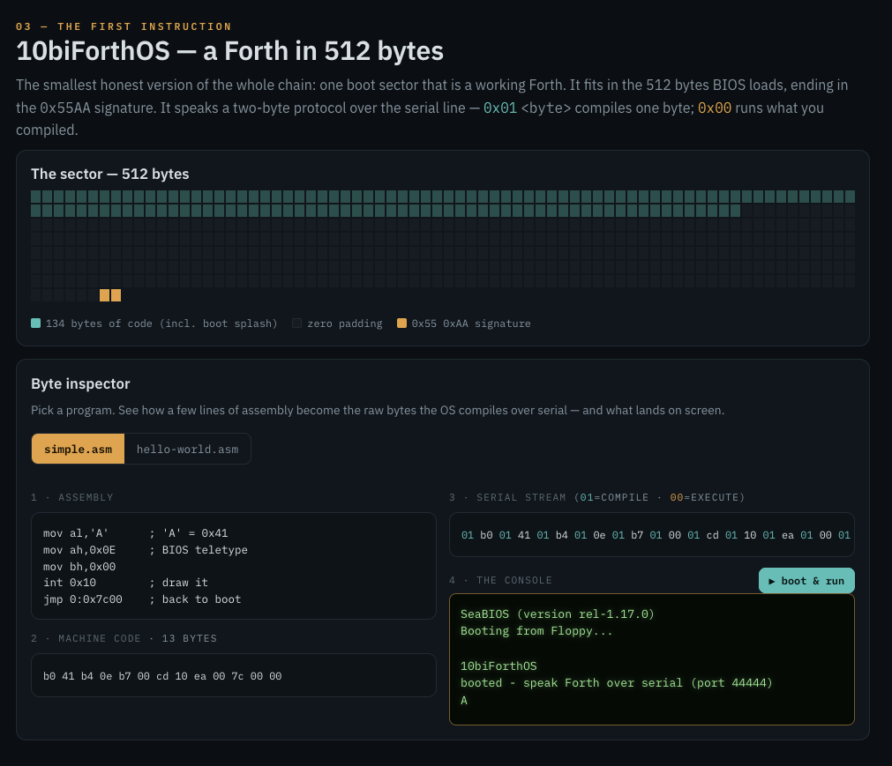

# Boot Chain Lab

> **`#>>`** This is the **BlueKit BlueChain Lab**. It's up to you to follow the
> white rabbit and find the red-team methodology &mdash; one's self. Measure the
> ground; never weaponize it.

Pre-OS integrity, taught and demonstrated end to end. Everything that runs before an
operating system does &mdash; firmware, boot sector, loader &mdash; is where the quietest
attacks live. This repo **measures** that ground instead of weaponizing it, and teaches how
it works from the first instruction up, then up through nine defensive detection labs.

## Pages

- **`index.html`** — interactive walkthrough: the boot chain, the ChainLoader
  snapshot→boot→evidence→rollback cycle, the 512-byte Forth OS byte inspector, and the SIGNAL log.
- **`live.html`** — a faithful **simulation** of booting `10biForthOS` over serial (real bytes
  and addresses, the `01 <byte> … 00` protocol), plus the Morpheus **chat over the wire**. The
  genuine CPU boot runs in QEMU on your machine: `make floppy && ./boot`.
- **`bench.html`** — the **ASCII & hex workbench**: the ASCII table, a live `xxd` / `hexdump -C`,
  hex→text, and classic chat ciphers (ROT13, Caesar, Atbash, XOR, Base64, hex, binary). Local-only.

## The lab (defensive detection)

1. **Boot persistence** · 2. **Detecting call-table hooks** · 3. **Cross-view detection**
· 4. **C2 detection** (beaconing + DNS tunneling) · 4B. **Stream integrity** (4+2 GF(256))
· 5. **Wire signatures** (MEOW / MS03-026) · 6. **Memory forensics** · 7. **Evidence timeline**
· 8. **NOP sled** · 9. **PE / Mach-O triage**. Next: ROP / JOP.

Each lab is analysis-only: it recognizes a technique, it does not build one.

## What's inside

- **`ChainLoader/`** — defensive boot-chain integrity simulator (BootKitStudio): marker-only,
  guardrailed, QEMU snapshot/rollback, JSON evidence. Build: `cmake -S . -B build && cmake --build build`.
- **`10biForthOS/`** — a Forth OS in a 512-byte boot sector, driven over serial. Build + run:
  `make floppy && ./boot`, then `./send examples/simple.asm` (upstream `https://git.sr.ht/~hocwp/10biForthOS`).
  Examples include `3xc.asm`, `wakeup.asm` (the Matrix intro), and `morpheus.asm` (guided serial chat).

## Safety

Defensive by design: no boot-sector or firmware writes, markers not payloads, VM-only, every
run snapshot/rollback-guarded. Follow the white rabbit to learn the offense &mdash; then build
the thing that catches it.
